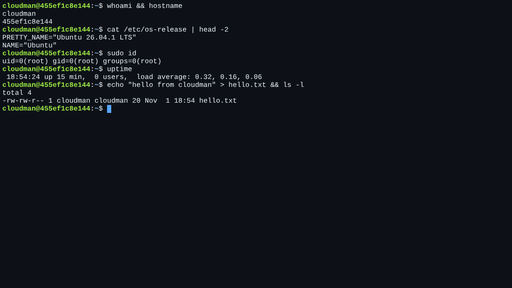
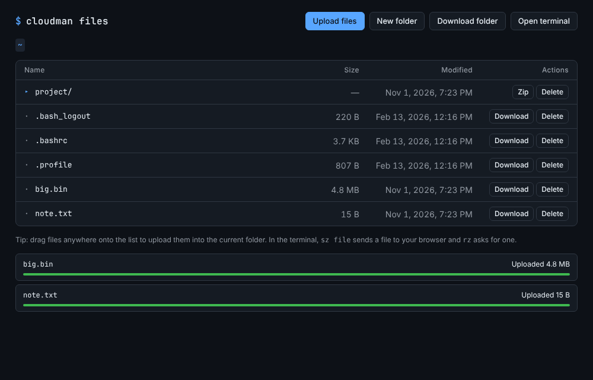

# cloudman

A Linux shell in your web browser. One Docker container runs
[ttyd](https://github.com/tsl0922/ttyd), which serves a real `bash` terminal
over HTTP/WebSocket, plus a small file manager for uploads and downloads.
Both sit behind the same username/password login.



## Moving files in and out

**File manager** at <http://localhost:7682>:

- Browse your home folder
- Upload with the button or by dragging files onto the list (with progress bars)
- Download any file, or a whole folder as a zip
- Create folders and delete files



**From the terminal** (ZMODEM, built into the web terminal):

- `sz myfile.txt` downloads the file to your browser
- `rz` shows a "choose files" button and uploads what you pick into the current folder

## What's inside

- Ubuntu base (`mcr.microsoft.com/devcontainers/base:ubuntu`) with git, curl, zsh
- ttyd, tmux, htop, vim, nano, ssh client, rsync, ping, lrzsz (`sz`/`rz`)
- File manager: `files/server.py` (Python standard library only) and `files/index.html`
- Login user `cloudman` with passwordless `sudo`
- Home directory on a Docker volume, so files survive restarts

## Run it

With Docker Compose:

```bash
WEB_PASS=choose-a-strong-password docker compose up -d --build
```

Or with plain Docker:

```bash
docker build -t cloudman .
docker run -d --name cloudman -p 7681:7681 -p 7682:7682 -e WEB_USER=admin -e WEB_PASS=choose-a-strong-password cloudman
```

Open <http://localhost:7681> and log in as `admin` with your password.
If you leave `WEB_PASS` out (plain `docker run` only), a random password is
generated and printed in `docker logs cloudman`.

## Settings

| Variable   | Default    | Meaning                     |
|------------|------------|-----------------------------|
| `WEB_USER` | `admin`    | Login name for the web page |
| `WEB_PASS` | (random)   | Login password              |
| `PORT`     | `7681`     | Terminal port inside the container |
| `FILES_PORT` | `7682`   | File manager port inside the container |
| `FILES_ENABLED` | `1`   | Set to `0` to turn the file manager off |

## Security notes

Anyone who logs in gets a root-capable shell. Basic auth over plain HTTP sends
the password unencrypted, so for anything outside your own machine or LAN put it
behind HTTPS (a reverse proxy such as Caddy or Traefik, or a Cloudflare/Tailscale
tunnel). Don't expose ports 7681 or 7682 straight to the internet.

The file manager runs as the `cloudman` user, can only reach `/home/cloudman`
(paths that try to escape it are refused), and its write actions require a
custom header so other websites can't trigger them from your browser.

The file manager's "Open terminal" link assumes the terminal is on port 7681 of
the same host. Behind a tunnel or reverse proxy with other hostnames, open the
terminal's own address instead.

## Building behind a TLS-intercepting proxy

The Dockerfile accepts an optional CA certificate as a BuildKit secret (it is
not stored in the image):

```bash
docker build --network host --build-arg https_proxy=$HTTPS_PROXY \
  --secret id=proxy_ca,src=/path/to/ca.crt -t cloudman .
```
